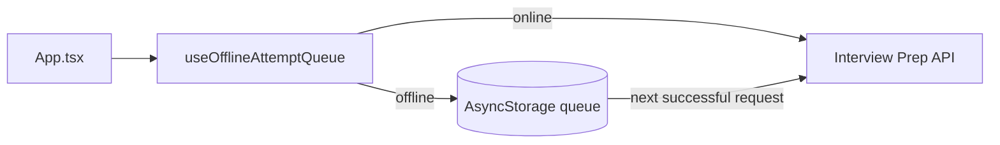

# Interview Prep Mobile

[](https://github.com/Deshraj-Jogiya/interview-prep-mobile/actions/workflows/ci.yml) 

A React Native (Expo) app for spaced-repetition interview practice against the [Interview Prep API](https://github.com/Deshraj-Jogiya/interview-prep-api).
It shows only the questions due today and keeps working offline.

## Highlights

- **Due-today list** with a streak and mastery summary, driven by the API's SM-2 scheduling.
- **Rate and reschedule:** tapping a question reveals a 1–5 self-rating that is sent as a practice attempt.
- **Offline first:** an attempt made without a network is stored in AsyncStorage and synced on the next successful request, never lost.
- **Tests:** React Native Testing Library for the full rating flow, the offline path, error and empty states, plus a separate suite for
  the offline queue hook.
- **Verified end to end:** a Metro web export served by nginx, loaded in headless Chromium on the same Docker network as the running API,
  rendered the seeded questions with zero console errors. Hermes' bytecode compiler has no arm64 Linux build, so a native build was not
  possible on that host.

## Architecture



## Stack

React Native, Expo, TypeScript, AsyncStorage, React Native Testing Library, Jest, GitHub Actions.

## Run it

```bash
npm install
export EXPO_PUBLIC_API_URL=http://localhost:5000
npm start
npm test
```
